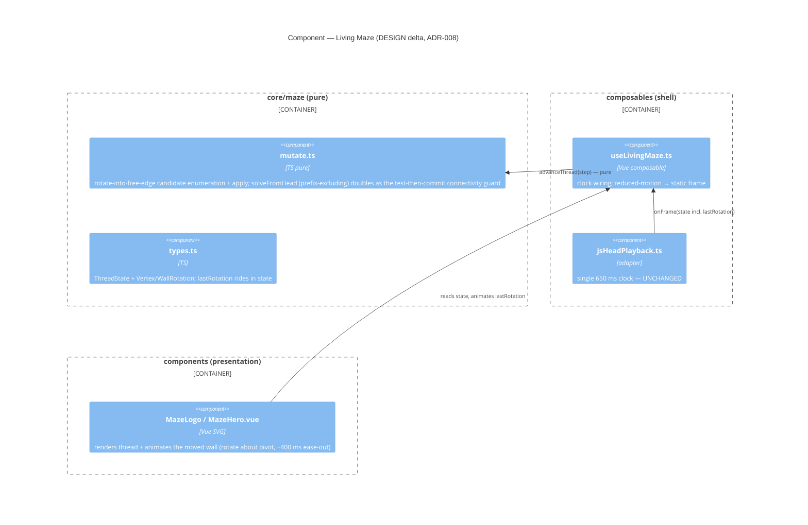

# Feature: living-maze

Evolving homepage maze (`MazeLogo.vue` / `MazeHero.vue`, pure pipeline in `core/maze/`) that
changes over time to *demonstrate* complexity and emergence rather than depict a maze. Brownfield
revisit; DISCOVER skipped — the problem is already validated by a prior nWave SPIKE + ADR-007.

- **Rigor**: Lean. **Density**: lean + ask-intelligent (`~/.nwave/global-config.json`).
- **Owner / sole editor**: Daniel Osborne.
- **Governing decision**: ADR-007 (Proposed) STANDS. A new ADR for the rotate-into-free-edge
  primitive + animation is authored in DESIGN.

---

## Wave: DISCUSS / [REF] Pre-requisites

- **ADR-007** (`docs/product/architecture/adr-007-living-maze.md`, Proposed) — fork-ahead engine
  behind a `ThreadPlayback` port; **past route fixed**; seed `23fc3a`. STANDS, not superseded.
- **seed-maze-generator** (DELIVERED) — pure `core/maze/` pipeline (generator, solver, renderer)
  + `MazeLogo.vue`/`MazeHero.vue`. The living maze builds directly on this.
- **Uncommitted WIP** to triage: `core/maze/mutate.ts`, `composables/playback/jsHeadPlayback.ts`,
  `composables/useLivingMaze.ts`, `core/maze/types.ts`, `tests/unit/maze/{mutate,playback}.test.ts`.
  Disposition: **keep & correct** (see [D5]).
- DISCOVER: ⊘ skipped (validated by SPIKE + ADR-007). DIVERGE: ⊘ n/a.

## Wave: DISCUSS / [REF] Persona ID

- **persona-prospective-client** — warm-referral visitor assessing credibility on the homepage
  before reading copy (architecture brief: the site is a "trust gate").
- Secondary actor: **owner-editor** — ships the maze; it must not read as broken.

## Wave: DISCUSS / [REF] JTBD one-liner

Traces to existing **JOB-MZ-002 "Visitor first-impression depth"** (`docs/product/jobs.yaml`,
opportunity 6, persona-prospective-client):

> "When I land on the homepage, I want the animated logo to reward a second look, so I feel the
> practice has depth and intentionality before I read a word."

- The living maze is the **fuller realization** of JOB-MZ-002 (evolution is what rewards the
  second look).
- The current WIP bug **undermines** the job: a maze that rewrites its own past reads as glitchy —
  signalling the opposite of "someone thought carefully about this." Fixing it is JOB-MZ-002
  conformance, not gold-plating.
- No new job discovered → JTBD re-run **skipped** (job already validated in SSOT).

## Wave: DISCUSS / [REF] Locked decisions

- **[D1]** Feature type: **User-facing** (homepage brand visual).
- **[D2]** Walking skeleton: **None** — layers already connect (seed-maze DELIVERED + running WIP
  wire core→composable→component). Architecture risk already resolved.
- **[D3]** UX research depth: **Lightweight** — single decorative element, existing validated job.
- **[D4]** JTBD: **trace to JOB-MZ-002**; do not re-run (validated in SSOT).
- **[D5]** WIP disposition: **keep & correct.** `mutate.ts` corrected in place (slice 1);
  `ThreadPlayback` port + `jsHeadPlayback` + `types.ts` changes reused for slice 3; the mutation
  primitive is replaced (open-a-wall → rotate-into-free-edge) in slice 2.
- **[D6]** ADR-007 STANDS. A **new ADR** for rotate-into-free-edge + animation is authored in DESIGN.
- **[D7]** **No deploy in scope** — shipping is owner-gated (no-push rule, Netlify credit cap).
  All waves produce locally-verifiable behavior only.

## Wave: DISCUSS / [REF] User stories

### US-LM-001 — Past route stays fixed  (`job_id: JOB-MZ-002`)

As a homepage visitor, when the maze evolves, the part I've already watched the thread travel must
stay put — only the region ahead of the head may change — so the maze reads as deliberate, not glitchy.

#### Elevator Pitch
Before: the running maze mutates walls *behind* the head and the thread re-enters cells it already
left, so the past visibly rewrites itself (reads as broken).
After: load the homepage with the living maze running → no wall on a travelled cell changes, and
the thread never re-enters a travelled cell; only the region ahead of the head evolves.
Decision enabled: the owner can ship the living maze knowing it reads as intentional (JOB-MZ-002),
not as a rendering glitch.

#### Acceptance Criteria
- **AC1** — Across a simulated run (≥1000 ticks, seed `23fc3a`), **zero** walls incident only to
  travelled cells (at/behind `headIndex`) change state. *(Currently violated: `mutateAhead`
  considers neighbours behind the head — `core/maze/mutate.ts:100`.)*
- **AC2** — After any mutation + re-solve, the re-solved path **never re-enters** a travelled cell;
  `solveFromHead` must exclude the fixed prefix. *(Currently violated: free BFS — `mutate.ts:55`.)*
- **AC3** — The drawn-behind prefix of `path` is identical before/after each tick (retain existing
  `advanceThread` assertion).
- **AC4** — A property-based test (fast-check) asserts AC1+AC2 for arbitrary seeds and head
  positions. **Deletion check**: reverting the fix fails the test (no Testing Theater).

### US-LM-002 — Walls change only by rotating into a free edge  (`job_id: JOB-MZ-002`)

As a homepage visitor, a wall change should look like a wall *pivoting* into an adjacent open slot,
not a wall blinking out of existence — so the motion (next story) is physically legible — and the
maze must stay solvable on every tick.

#### Elevator Pitch
Before: the engine mutates by *opening* an existing wall (removing it) — a change that can only
read as a wall vanishing.
After: load the homepage → every wall change is a single wall segment moving from one cell edge to
an adjacent edge that currently has no wall (rotate-into-free-edge), and head→exit stays solvable
on every tick.
Decision enabled: confirms enough rotatable moves exist at the frontier to keep the maze lively
under the constrained primitive — *before* investing in animation.

#### Acceptance Criteria
- **AC1** — The mutation primitive selects only moves expressible as one wall segment rotating ~90°
  about a shared endpoint into an edge that currently has **no** wall. No pure open/close toggles.
- **AC2** — Test-then-commit connectivity guard (reuse the BFS guard in
  `core/maze/generator.ts`): a candidate move that would disconnect head→exit is rejected; the
  engine tries another or no-ops (never blank). **0** disconnection events across ≥1000 ticks.
- **AC3** — Liveliness: **≥60%** of ticks produce a visible frontier change under the rotate-only
  primitive (spike baseline for opens ≈89%; rotate is more constrained — see learning hypothesis,
  slice 02). If <60%, surface for re-design before slice 03.
- **AC4** — Mutations stay confined to the frontier (cells 2–5 ahead) **and** honour US-LM-001
  (no travelled-cell change).

### US-LM-003 — Walls move, not snap  (`job_id: JOB-MZ-002`)

As a homepage visitor, when a wall changes I should see it *move* (pivot around one end) over a
short interval, not teleport — so the evolution reads as living, rewarding the second look
JOB-MZ-002 describes.

#### Elevator Pitch
Before: walls update instantaneously between frames — the change is a snap, easy to miss or read
as a flicker.
After: load the homepage → a changing wall visibly pivots around one endpoint into its new edge
over a short interval (duration set in DESIGN), respecting `prefers-reduced-motion`.
Decision enabled: the visitor perceives deliberate, living motion (JOB-MZ-002 "depth and
intentionality"), not a glitch or a distraction.

#### Acceptance Criteria
- **AC1** — A wall change renders as a continuous rotation about one endpoint (not an
  opacity/position snap).
- **AC2** — `prefers-reduced-motion: reduce` → no animation; a single static, valid frame (reuse
  the existing reduced-motion branch in `composables/useLivingMaze.ts:67`).
- **AC3** — Animation does not block first paint and does not regress homepage interactivity
  (no main-thread jank beyond frame budget on a mid-tier device — DESIGN to quantify).
- **AC4** — Motion is confined to the frontier; travelled walls are visually static (consistency
  with US-LM-001).

## Wave: DISCUSS / [REF] Out-of-scope

- Deploying the living maze (owner-gated; no-push rule).
- `cssDashPlayback` / `staticPlayback` adapters beyond the existing reduced-motion static frame
  (ADR-007 defers these).
- Re-route-primary mechanism (ADR-007 rejected — fork-ahead stays primary).
- Seed selection / curation UI (JOB-MZ-001, separate feature).
- Changing maze size, palette, or layout.

## Wave: DISCUSS / [REF] WS strategy

**None / brownfield.** The skeleton (core pure pipeline → composable clock → component SVG) is
already proven by the DELIVERED seed-maze-generator and the running WIP. No new integration points.

## Wave: DISCUSS / [REF] Driving ports

- Inbound surface: homepage render — `pages/index.vue` → `MazeHero.vue`/`MazeLogo.vue` →
  `useLivingMaze` composable. No CLI/HTTP.
- Pure policy (core): rotate-into-free-edge mutation + `solveFromHead` (prefix-excluding).
- Playback port: `ThreadPlayback` (provisional, ADR-007) — the clock lives in the shell.

## Wave: DISCUSS / [REF] Definition of Done

1. All ACs for the slice green (Vitest unit + property tests where specified).
2. `core/maze` purity preserved — dependency-cruiser green (no Vue/Nuxt import in core).
3. Past-route invariant property-tested (US-LM-001 AC4) — deletion check passes.
4. Connectivity guard test green; 0 disconnection events across the simulated run.
5. `prefers-reduced-motion` path verified (static frame, no motion).
6. No Testing Theater — every new test fails when its production code is reverted.
7. Local verification via preview (homepage renders; behavior observed) — not "looks fine."
8. Conventional, atomic commits; ADR follow-up noted for DESIGN.
9. **No deploy/push without explicit owner approval** (Netlify credit cap).

## Wave: DISCUSS / [REF] Outcome KPIs

| KPI | Target | Method |
|-----|--------|--------|
| Past-route wall mutations | 0 across ≥1000 ticks (seed `23fc3a`) | engine simulation counter (unit/property) |
| Thread re-entry into travelled cells | 0 | `solveFromHead` exclusion test |
| Disconnection events (head→exit) | 0 across ≥1000 ticks | connectivity guard test |
| Frontier liveliness (visible change / tick) | ≥60% | engine simulation harness |
| Reduced-motion compliance | 100% static, 0 motion | component test |

## Wave: DISCUSS / [REF] Definition of Ready: PASS

1. Job traceability — all 3 stories → JOB-MZ-002 (SSOT). ✓
2. Elevator pitch per story (Before/After/Decision-enabled). ✓
3. ACs testable + unambiguous (quantified: 0 violations, ≥60% liveliness). ✓
4. Outcome KPIs with numeric targets + method. ✓
5. Out-of-scope explicit. ✓
6. Dependencies known (WIP kept & corrected; ADR-007 stands). ✓
7. No cross-context complexity (single bounded context). ✓
8. Sizing agreed — one slice, owner decision (`slices/slice-01-living-maze.md`). ✓
9. Architecture risk resolved (brownfield; layers proven by seed-maze + WIP). ✓

## Wave: DISCUSS / [REF] Scope Assessment: PASS

3 stories → **1 slice** (`slices/slice-01-living-maze.md`) by owner decision, with three ordered
internal checkpoints (invariant → primitive → animation). One bounded context (maze),
core↔shell↔presentation only (project default). No oversize signals. The single slice is thicker
than the carpaccio ≤1-day ideal; mitigation: each checkpoint is independently verifiable, so the
de-risking order is preserved on one branch.

## Wave: DISCUSS / [REF] Wave Decisions Summary

- **Primary job**: JOB-MZ-002 (visitor first-impression depth). Living maze is its fuller
  realization; the WIP bug undermines it.
- **Feature type**: user-facing. **WS**: none (brownfield).
- **Slice**: **1 slice** (owner decision) delivering all 3 stories, with three ordered internal
  checkpoints — (1) past-route invariant [correctness]; (2) rotate-into-free-edge primitive +
  connectivity [liveliness under constraint]; (3) animated wall rotation [motion legibility].
  **Build order 1→2→3** (correctness / highest-uncertainty first), single branch.
- **WIP**: keep & correct ([D5]). **ADR-007 stands**; new ADR in DESIGN ([D6]).
- **Upstream changes**: none (DISCOVER skipped; JOB-MZ-002 unchanged, story IDs appended to SSOT).

---

## Wave: DESIGN / [REF] DDD list

- **[DD1]** Past-route invariant enforced in pure core — mutation candidates + `solveFromHead`
  exclude cells at/behind the head. (US-LM-001; ADR-008 §1)
- **[DD2]** Mutation primitive = rotate-into-free-edge (open `E_src` + close `E_dst` about a shared
  vertex; wall count conserved). Replaces open-a-wall. (US-LM-002; ADR-008 §2)
- **[DD3]** Test-then-commit connectivity guard via `solveFromHead(head)` — reject moves that
  disconnect head→exit; never blank. (US-LM-002 AC2; ADR-008 §3)
- **[DD4]** One clock — reuse `jsHeadPlayback` (650 ms); rotation animates declaratively in the
  renderer (~400 ms ease-out). rAF deferred. (US-LM-003; ADR-008 §4)
- **[DD5]** Rotation rides inside `ThreadState.lastRotation`; `ThreadPlayback` port **unchanged** —
  validates ADR-007's provisional shape. (ADR-008 §5)
- **[DD6]** Pure Core / Shell holds — policy in `core/maze/`, clock + SVG transform in shell/
  presentation; dependency-cruiser green. (ADR-008 §7)

## Wave: DESIGN / [REF] Component decomposition

| Component | Path | Layer | Change |
|-----------|------|-------|--------|
| Rotation policy | `core/maze/mutate.ts` | core (pure) | EXTEND — candidate enumeration + apply + guard |
| Prefix-excluding solve | `core/maze/mutate.ts` `solveFromHead` | core (pure) | EXTEND — exclude travelled prefix; reuse as guard |
| Types | `core/maze/types.ts` | core | EXTEND — `Vertex`, `WallRotation`, `ThreadState.lastRotation?` |
| Clock wiring | `composables/useLivingMaze.ts` | shell | EXTEND — pass `lastRotation`; reduced-motion branch exists |
| Playback adapter | `composables/playback/jsHeadPlayback.ts` | shell | UNCHANGED (one-clock) |
| SVG renderer | `components/MazeLogo.vue`, `MazeHero.vue` | presentation | EXTEND — animate moved wall (transform-origin = pivot) |

## Wave: DESIGN / [REF] Driving ports

- Inbound: homepage render — `pages/index.vue` → `MazeHero`/`MazeLogo` → `useLivingMaze`. No CLI/HTTP.

## Wave: DESIGN / [REF] Driven ports + adapters

| Port | Location | Adapter | Change |
|------|----------|---------|--------|
| `ThreadPlayback` (clock over pure `step`) | `core/maze/types.ts` | `jsHeadPlayback` | port shape UNCHANGED; `lastRotation` rides in `ThreadState` |
| (deferred) `cssDashPlayback`, `staticPlayback` | — | — | out of scope (ADR-007 defer) |

## Wave: DESIGN / [REF] Technology choices

No new technology. TypeScript (type-stripped) pure core; Vue 3 SVG for the transform; CSS/SVG
declarative transition for the rotation. Vitest + fast-check for the invariant/guard property tests.
(All pinned versions per `brief.md` Technology Stack.)

## Wave: DESIGN / [REF] Decisions table

| ID | Decision |
|----|----------|
| DD1 | Past-route invariant in pure core |
| DD2 | Rotate-into-free-edge primitive |
| DD3 | Test-then-commit connectivity guard |
| DD4 | One clock; ~400 ms ease-out declarative rotation |
| DD5 | `lastRotation` in `ThreadState`; port unchanged |
| DD6 | Pure Core / Shell boundary preserved |

## Wave: DESIGN / [REF] Reuse Analysis

| Existing Component | File | Overlap | Decision | Justification |
|--------------------|------|---------|----------|---------------|
| `mutateAhead` / `withPassage` | `core/maze/mutate.ts` | mutation select + apply | **EXTEND** | Swap open-only for rotate (open `E_src` + close `E_dst`); same module/shape + candidate enumeration + guard. |
| `solveFromHead` | `core/maze/mutate.ts` | BFS head→exit | **EXTEND** | (a) add prefix-exclusion (invariant); (b) reuse as the test-then-commit guard. No new BFS. |
| `bfsReachable` | `core/maze/generator.ts` | connectivity BFS | **REUSE (pattern)** | Guard reuses `solveFromHead`; `bfsReachable` is the generator's own — no duplication. |
| `ThreadState` / types | `core/maze/types.ts` | frame payload | **EXTEND** | Add `Vertex`/`WallRotation` + optional `lastRotation`. No port reshape. |
| `jsHeadPlayback` | `composables/playback/jsHeadPlayback.ts` | clock | **UNCHANGED** | One-clock model; animation declarative in renderer. rAF deferred behind same port. |
| `useLivingMaze` | `composables/useLivingMaze.ts` | shell wiring | **EXTEND** | Pass `lastRotation`; reduced-motion branch already present. |
| `MazeLogo` / `MazeHero` | `components/` | SVG render | **EXTEND** | Add rotation transition (transform-origin = pivot vertex). |

**Zero CREATE NEW.** Outcome Collision Check: `docs/product/outcomes/registry.yaml` is **absent** —
this project does not maintain an outcomes registry, so the check is **N/A** (not skipped silently).

## Wave: DESIGN / [REF] C4 Component (L3 — maze subsystem delta)

> L1 System Context and L2 Container are **unchanged** — see `docs/product/architecture/brief.md`.
> Only the maze subsystem's internals change; the L3 below shows the rotation data flow.

## Wave: DESIGN / [REF] Open questions (→ DELIVER / owner)

- **Rotation duration / easing** — proposed ~400 ms ease-out (taste call; owner to ratify/tune).
- **Liveliness under rotate-only** — measure in DELIVER; target ≥60% of ticks show a visible change.
  If <60%, revisit (hybrid open, or two-clock). This is the highest-risk question.
- **rAF interpolation** — deferred; trigger = 650 ms discrete stepping reads as choppy.

## Wave: DESIGN / [REF] Architecture Summary (wave-decisions)

- **Pattern**: existing modular monolith / Pure Core / Imperative Shell — **unchanged**. This wave
  designs *deltas* only.
- **Paradigm**: Functional (Pure Core/Shell) — already set in project CLAUDE.md + ADR-001; not re-asked.
- **Key components**: rotation policy (core), connectivity guard (core, via `solveFromHead`),
  declarative rotation render (presentation). Port unchanged.
- **New ADR**: ADR-008 (Proposed) — extends ADR-007 (which STANDS).
- **Constraints**: dependency-cruiser core purity; connectivity guarded per mutation; reduced-motion
  static; no deploy without owner approval.
- **Upstream changes**: none — ADR-007 stands; DISCUSS stories unchanged.
